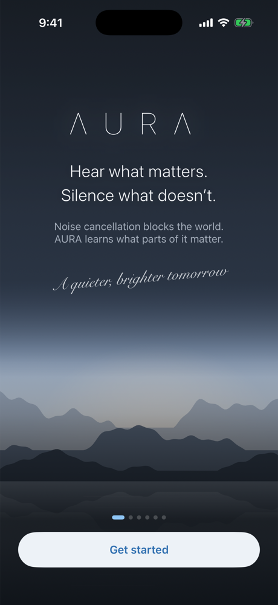
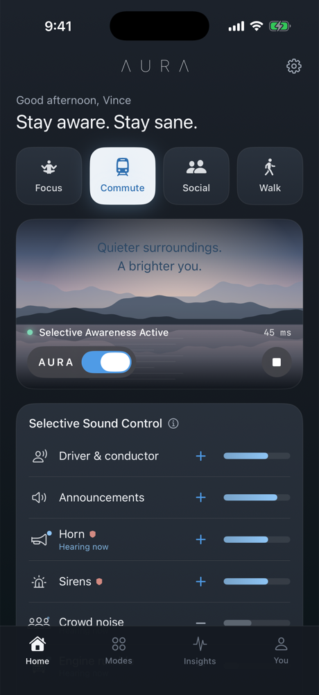
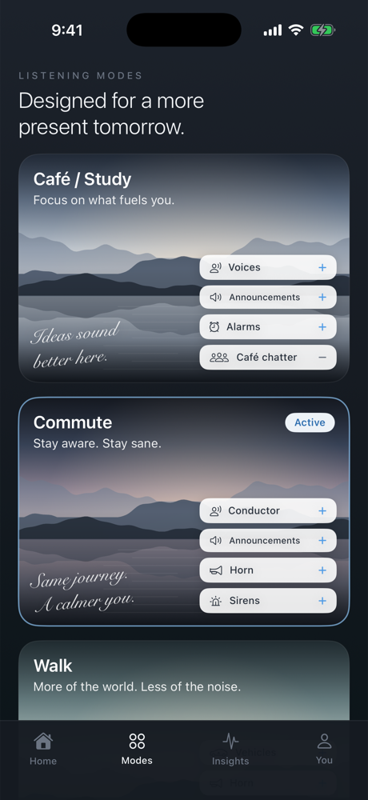
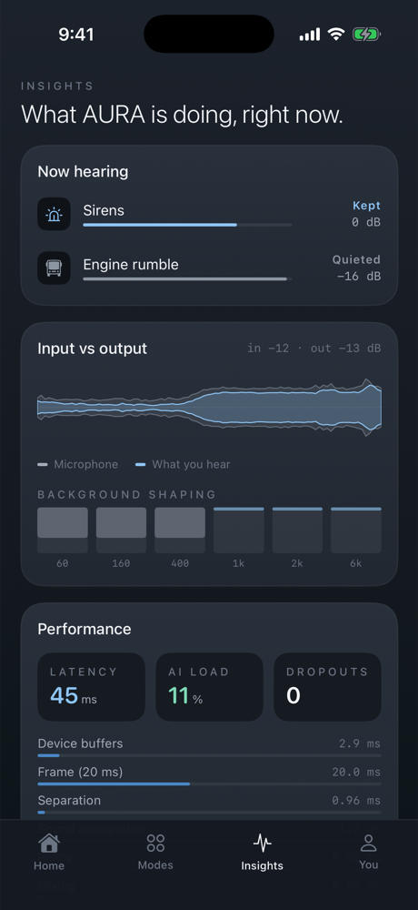
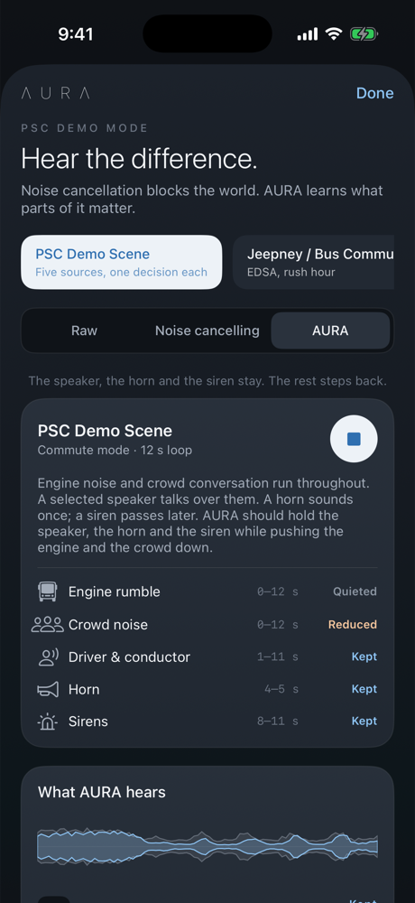
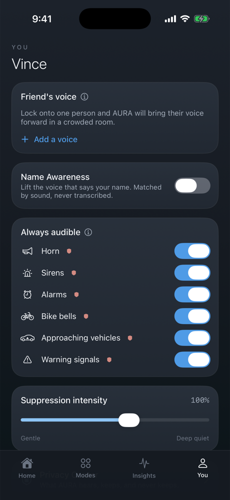

# AURA for iPhone

The AURA app: the full Selective Awareness engine running **on the phone**, in
real time, between the microphone and your earbuds.

```
iPhone microphone ──► AuraCore (on-device) ──► earbuds / headphones
                     separation · recognition · policy · safety · mixing
```

| Welcome | Home, live | Modes |
|---|---|---|
|  |  |  |
| **Insights** | **Demo** | **You** |
|  |  |  |

Screenshots are from the iPhone 17 Pro simulator with the PSC demo scene running
through the real engine: the latency, load and detections shown are live.
Regenerate them with `tools/screenshots.sh`.

## Layout

| Path | What it is |
|---|---|
| `AuraCore/` | The engine as a Swift package. No UI, no AVFoundation — samples in, samples out. Tested on macOS with `swift test`. |
| `AuraApp/` | The SwiftUI app: audio I/O, model, and the branded interface. |
| `Aura.xcodeproj` | Xcode project. Folders are file-system-synchronized, so new files need no project edits. |
| `tools/render_icon.swift` | Renders the app icon. |
| `tools/screenshots.sh` | Builds, installs in a simulator, captures every screen (debug-only launch arguments such as `-AuraScreen insights -AuraDemo psc_demo`). |

## Build and run

Open `Aura.xcodeproj` in Xcode 26, pick an iPhone simulator or your device, and run.
From the command line:

```bash
xcodebuild -project Aura.xcodeproj -scheme Aura \
  -destination 'platform=iOS Simulator,name=iPhone 17 Pro' build
```

On a device, set your team under *Signing & Capabilities*. **Use headphones for
live listening.** The app refuses to route the microphone to the phone speaker,
because that feeds back.

Run the engine tests:

```bash
cd AuraCore && swift test
```

## How the engine got to the phone

`AuraCore` is a line-by-line port of the Python reference engine in `/src/aura`.
It is checked against the reference on the **same audio**:
`scripts/export_ios_fixtures.py` renders the demo scenes and test sources from
the Python synthesiser, and the Swift tests assert the same properties the
Python tests do.

| | Python reference | Swift on-device |
|---|---:|---:|
| Engine band (20–300 Hz), PSC scene | −8.7 dB | **−8.7 dB** |
| Horn/siren band (400–3500 Hz) | −0.6 dB | **−0.6 dB** |
| Siren while sounding — AURA / ANC | +0.6 / −8.0 dB | **+0.6 / −8.0 dB** |
| Separator reconstruction | 153 dB (float64) | **135 dB** (float32) |
| Demo scenes as scripted | 22/24 | **22/24** (same two misses) |
| Person Lock, 4 speakers | 4/4 | **4/4** |
| Processing per 20 ms hop | 1.3 ms | **0.18 ms** (release, M-series) |

## Threads

| Thread | Work | Rule |
|---|---|---|
| Audio render | Separation, recognition, policy, mixing (~0.2 ms per 20 ms hop) | Never blocks. Settings are read with a try-lock and a cached copy; speech goes out through a lock-free ring. |
| Semantic worker | Person Lock, Name Awareness (1–1.5 s windows) | Would miss the audio deadline if it ran inline, and who is speaking doesn't change every 20 ms. |
| Main | UI; polls the engine's snapshot 12×/s | The engine never calls into SwiftUI. |

The mic is captured with an `AVAudioSinkNode` and output is produced with an
`AVAudioSourceNode`, both on the render thread. An `installTap` would deliver
audio in chunks of roughly 100 ms, which is far too late for the ear.

## The brand in the app

- **ΛURΛ wordmark**: SF Pro Ultralight with wide tracking and the chevron A.
- **Palette**: dark slate glass, sky blue for what AURA lets through, slate for what it turns down, warm sunrise for accents, coral kept for safety.
- **Photography**: the brand sheet uses photographs. The app draws a mountain lake procedurally instead, with a different mood per mode, so it ships with no image assets.
- **Handwritten accents** ("Same journey. A calmer you.") use Snell Roundhand.
- **Selective Sound Control**: each row is icon · label · **+/−** · level bar. `+` lets a sound through and `−` turns it down. Drag the bar for finer control. A shield marks sounds that always stay audible.

## Honest limitations

- **Bluetooth adds latency outside AURA's control.** With AirPods over A2DP,
  iOS adds roughly 150–250 ms of output buffering. Wired or USB-C headphones
  give the real ~45 ms experience. Truly transparent latency needs AURA inside
  the earbud, which is what the brand sheet's hardware depicts.
- **Microphone:** AURA captures from the iPhone's microphone and plays to the
  earbuds. Using the earbuds' own microphones would force the Bluetooth hands-free
  profile: 16 kHz call-quality audio in both directions.
- **Real-time hygiene:** the render path still allocates a few small Swift
  arrays per hop (event and decision lists). It has run without dropouts in
  testing, but a production build should move these to preallocated buffers.
- Every limitation of the reference engine applies here too; see
  [`/docs/LIMITATIONS.md`](../docs/LIMITATIONS.md).
